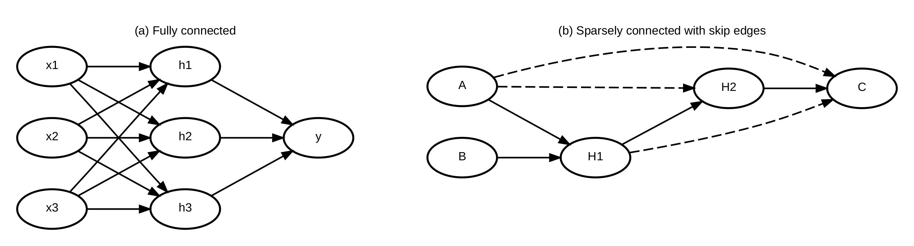

# Why kpnn2

[Home](index.md#why-it-exists) gives three reasons to use `kpnn2`.
This page gives the evidence for each one, after a short background
on what a knowledge-primed network needs from PyTorch:

- **Built on, not rebuilt.** [Building blocks](#building-blocks)
  lists the parts you start from and where each one is shown.
- **Less code, less to get wrong.**
  [Why not custom PyTorch?](#why-not-custom-pytorch) builds one
  network both ways.
- **Checked for correctness.**
  [Checks where names meet tensor positions](#checks-where-names-meet-tensor-positions)
  lists every check.

To build a first model instead, start with the
[quick start](index.md#quick-start).

## What a KPNN needs from PyTorch

A [knowledge-primed neural network](concepts.md#kpnn) (KPNN) takes
its wiring from a [prior](concepts.md#prior) — what you take as
known before training. In the form that
[Fortelny and Bock (2020)](https://doi.org/10.1186/s13059-020-02100-5)
introduced, shown in [Figure 1 on Home](index.md#what-it-is), the
network runs against the direction of signaling. Gene expression
enters at the input nodes, passes through transcription factors and
kinases in the hidden layers, and reaches the receptor at the
output node.

Connections the prior does not contain are absent rather than
merely small. So sparsity, which elsewhere in deep learning serves
speed or memory, here carries the meaning of the model.

Related models, also called visible or biologically informed neural
networks, take the prior from pathway databases or ontologies.
P-NET, for example, is built on a hierarchy of Reactome pathways
([Elmarakeby et al., 2021](https://doi.org/10.1038/s41586-021-03922-4)).

PyTorch can express such networks, but its standard layers do not.
`nn.Linear` connects every unit of one layer to every unit of the
next (Figure 1a). A KPNN connects only the pairs its prior names,
and many of its edges skip layers: these
[skip edges](concepts.md#skip-edge) are dashed in Figure 1b. The
common workaround multiplies each weight matrix by a fixed 0/1 mask
that you derive from the prior yourself.



**Figure 1.** (a) Dense adjacent layers, the usual PyTorch case.
(b) A sparsely connected network with skip edges (dashed), the same
graph as on the [Edges that skip layers](skip-edges.ipynb) page.

Deriving the masks turns names into positions: each node becomes
an index, and each edge a cell of a mask. Nothing in PyTorch
checks later that names and positions still agree. When they drift
apart — after a database update, with a reordered feature table, or
on reloading a checkpoint — the model still trains, and its
[attributions](concepts.md#attribution) land on the wrong names.

## Building blocks

Published KPNN code is typically written for one architecture, so
each new project rebuilds the parsing, the masks, and the checks.
`kpnn2` provides them as tested parts of four kinds:

- **Parsers.** `parse_layered()` sorts an acyclic prior into layers
  and gives every layer after the inputs one
  [hop](concepts.md#hop) — every edge that enters it, skip edges
  included. `parse_adjacency()` places all nodes in one
  [state vector](concepts.md#state-vector), which allows feedback
  loops and self-loops.
- **Sparse layers.** `PackedLinear` (one trainable weight per
  edge), `MaskedLinear` (a masked dense matrix for small graphs),
  and `PackedMultiheadAttention` (attention restricted to the
  prior's edges) take the place of `nn.Linear` and
  `nn.MultiheadAttention`.
- **Name alignment.** `align_inputs()` orders feature columns by
  name, and `map_node_attributions()` labels attribution tensors
  with node names.
- **Checks.** Malformed priors, missing input columns, checkpoints
  from a different prior, and attribution tensors of the wrong
  width raise `Kpnn2Error`;
  [Checks where names meet tensor positions](#checks-where-names-meet-tensor-positions)
  lists each check.

The tutorials show them at work:
[Edges that skip layers](skip-edges.ipynb) for skip edges,
[Cyclic graph example](cyclic-graph-example.ipynb) for feedback
loops, and [Transformer example](transformer-example.ipynb) for
attention. [Supported architectures](supported.md) lists the model
families they cover. [How we test](how_we_test.md) describes the
tests behind them.

Everything else — activations, output heads, losses, the training
loop, and the attribution method — stays in PyTorch code you
write. There is no model compiler and no ready-made network, so the
model stays plain PyTorch that you can read, change, and extend.

## Why not custom PyTorch?

A pathway prior is still a feedforward network, so you *can*
write one in plain PyTorch: sort the named nodes into layers,
build a mask for each hop, and pass `W * mask` to `F.linear`.
Written out, that preparation is a
[parser](concepts.md#parser) — the code on the left
below is one. It also has to be rerun by hand: a single edge
added to the table can move nodes between layers, and the masks,
the layers each hop reads, and the column order of every
concatenated input all change with it.

`kpnn2` replaces that preparation with one call to
`parse_layered()` and leaves the `nn.Module` as a loop over hops.
The edgelist stays the only description of the graph, skip edges
arrive already packed into the hops that read them, and
`align_inputs()` matches input names rather than positions.
[**Edges that skip layers**](skip-edges.ipynb) works through
the same point in a full example.

<div>

</div>

**Figure 2.** A sparse pathway prior: genes feeding transcription
factors, kinases, cellular processes and a phenotype. Solid edges
connect adjacent layers; dashed edges skip one. Both snippets
below build this network from the same edgelist.

<div class="grid code-compare" markdown>

<div markdown>

**Custom PyTorch**

```python
from collections import defaultdict, deque
import pandas as pd
import torch
import torch.nn.functional as F
from torch import nn

edgelist = pd.read_csv("pathway_prior.csv")

missing = {"source", "target"} - set(
    edgelist.columns
)
if missing:
    raise ValueError(
        f"missing columns: {sorted(missing)}"
    )
pairs = edgelist[["source", "target"]]
if pairs.isna().any().any():
    raise ValueError("missing node names")
pairs = pairs.astype(str)
if (pairs == "").any().any():
    raise ValueError("empty node names")
loop_nodes = pairs["source"][
    pairs["source"] == pairs["target"]
]
if len(loop_nodes):
    raise ValueError(
        f"self-loops: {sorted(set(loop_nodes))}"
    )
if pairs.duplicated().any():
    raise ValueError("duplicate edges")

parents = defaultdict(set)
children = defaultdict(list)
nodes = set()
for source, target in zip(
    pairs["source"],
    pairs["target"],
):
    parents[target].add(source)
    children[source].append(target)
    nodes.add(source)
    nodes.add(target)

# Kahn's algorithm: recursion would overflow
# the stack on a deep graph and never return
# on a cyclic one. What it leaves unranked
# is the cycle.
in_degree = {
    name: len(parents[name]) for name in nodes
}
ready = deque(
    name
    for name in sorted(nodes)
    if in_degree[name] == 0
)
depths = {}
while ready:
    name = ready.popleft()
    if parents[name]:
        depths[name] = 1 + max(
            depths[parent]
            for parent in parents[name]
        )
    else:
        depths[name] = 0
    for child in children[name]:
        in_degree[child] -= 1
        if in_degree[child] == 0:
            ready.append(child)
if len(depths) < len(nodes):
    unranked = sorted(nodes - depths.keys())
    raise ValueError(f"cycle: {unranked}")

by_layer = defaultdict(list)
for name, depth in depths.items():
    by_layer[depth].append(name)
layers = [
    tuple(sorted(by_layer[depth]))
    for depth in range(max(by_layer) + 1)
]
masks = []
for depth in range(1, len(layers)):
    src_layers = []
    for src_depth, layer in enumerate(
        layers[:depth]
    ):
        if any(
            source in parents[target]
            for target in layers[depth]
            for source in layer
        ):
            src_layers.append(src_depth)
    col_of = {}
    col = 0
    for src_depth in src_layers:
        for name in layers[src_depth]:
            col_of[name] = col
            col += 1
    mask = torch.zeros(
        len(layers[depth]),
        col,
    )
    for row, target in enumerate(layers[depth]):
        for source in parents[target]:
            mask[row, col_of[source]] = 1.0
    masks.append((src_layers, mask))


class Net(nn.Module):
    def __init__(self, masks, n_inputs):
        super().__init__()
        self.n_inputs = n_inputs
        self.src_layers = [
            src for src, _ in masks
        ]
        self.lins = nn.ModuleList()
        self.masks = nn.ParameterList()
        for _, mask in masks:
            self.lins.append(
                nn.Linear(
                    mask.shape[1],
                    mask.shape[0],
                )
            )
            self.masks.append(
                nn.Parameter(
                    mask,
                    requires_grad=False,
                )
            )
        self.acts = nn.ModuleList(
            [
                nn.ReLU()
                for _ in self.lins
            ]
        )

    def forward(self, x):
        # Width is checkable, column order is
        # not: ordering x to match layers[0]
        # stays the caller's job.
        if x.shape[-1] != self.n_inputs:
            raise ValueError(
                f"expected {self.n_inputs} "
                f"columns, got {x.shape[-1]}"
            )
        saved = {0: x}
        h = x
        for i, (lin, mask) in enumerate(
            zip(self.lins, self.masks)
        ):
            parts = [
                saved[src]
                for src in self.src_layers[i]
            ]
            inp = (
                parts[0]
                if len(parts) == 1
                else torch.cat(parts, 1)
            )
            h = F.linear(
                inp,
                lin.weight * mask,
                lin.bias,
            )
            if i + 1 < len(self.lins):
                h = self.acts[i](h)
            saved[i + 1] = h
        return h


model = Net(masks, len(layers[0]))
```

</div>

<div markdown>

**kpnn2**

```python
import pandas as pd
from torch import nn

import kpnn2

edgelist = pd.read_csv("pathway_prior.csv")
spec = kpnn2.parse_layered(edgelist)


class Net(nn.Module):
    def __init__(self, spec: kpnn2.LayeredSpec):
        super().__init__()
        self.spec = spec
        self.lins = nn.ModuleList(
            [
                kpnn2.PackedLinear.from_hop(
                    hop,
                    identity=spec.fingerprint,
                )
                for hop in spec.hops
            ]
        )
        self.acts = nn.ModuleList(
            [
                nn.ReLU()
                for _ in spec.hops
            ]
        )

    def forward(self, x):
        saved = {0: x}
        h = x
        for i, (lin, hop) in enumerate(
            zip(self.lins, self.spec.hops)
        ):
            h = lin(kpnn2.gather_hop_inputs(saved, hop))
            if i + 1 < len(self.lins):
                h = self.acts[i](h)
            saved[i + 1] = h
        return h


model = Net(spec)
```

</div>

</div>

Both columns are correct. They build the same network, and both
reject the same six malformed edgelists. The left one is several
times longer, and it covers only the model: aligning input
columns, saving checkpoints, and naming attributions still lie
ahead, each with bookkeeping of its own.

Much of that length is not the model but the checks the masks
depend on. A missing node name silently adds a node, a duplicated
edge silently collapses into one weight, and a cycle has no
layering at all, so the depth pass has to detect it rather than
recurse forever. The left column holds every check its author
thought of. The failure below is one they did not.

### A checkpoint that loads the wrong wiring

Train the left model and save its `state_dict`. Months later, a
new database release revises one interaction in Figure 2:
`gene_n3` now regulates `tf_stat` instead of `tf_nfkb`. No node
changes layer, so every tensor keeps its shape. Rerun the left
column on the new prior and reload the checkpoint:

```python
# Before: trained on the old pathway_prior.csv
torch.save(model.state_dict(), "model.pt")

# After: the same script on the new pathway_prior.csv
model = Net(masks, len(layers[0]))
model.load_state_dict(torch.load("model.pt"))
# <All keys matched successfully>
```

The load succeeds, even with `strict=True`. The masks are
`nn.Parameter`s, so they are saved in the `state_dict`, and the
old masks overwrite the new ones. The model runs the old wiring
while every name in the script comes from the new prior. Loss and
predictions look normal. Every attribution on `gene_n3` flows
through `gene_n3 → tf_nfkb`, an edge the new prior says does not
exist.

The obvious fix moves the failure instead of removing it.
Register the masks as non-persistent buffers so they stay out of
the `state_dict`, and the load still succeeds. Now the new masks
gate weights trained under the old ones: `gene_n3 → tf_stat` runs
on a weight that never trained, and the trained
`gene_n3 → tf_nfkb` weight sits behind a zero.

With `kpnn2`, the same reload raises:

```python
model = Net(spec)  # the new pathway_prior.csv
model.load_state_dict(torch.load("model.pt"))
```

```text
Kpnn2Error: The checkpoint identity does not match this layer. The
mismatch is in submodule 'lins.0'. The checkpoint was saved with
identity '0f59017a8609...'; this layer has identity
'46a9dc2f04f2...'. Load a checkpoint saved from a layer built from
the same spec (with identity=spec.fingerprint). To move weights
onto a different prior, copy them by name with edge_location() on
the old and the new spec; see 'Changing the prior (reparse)' on the
PackedLinear page of the kpnn2 docs.
```

Each `PackedLinear` saves a digest of its packed indices and,
with `identity=spec.fingerprint`, the fingerprint of the named
prior. When either differs from the layer being loaded, loading
stops with `Kpnn2Error`.

Each failure like this one is fixable once you have seen it. The
hard part is seeing all of them in advance: this one needs a
prior update and a reload to appear, and neither column's code
hints at it.
[Three mistakes in hand-written code](how_we_test.md#three-mistakes-in-hand-written-code)
on How we test shows three more, each a few lines of plain PyTorch
that run without an error.

That is what `kpnn2` is for. It owns the mapping
from node names to tensor positions (layers, packed edges, input
columns, checkpoints, attribution labels), so the checks on that
mapping are written and tested once, in one place, instead of
rediscovered by every project that writes its own.

## Checks where names meet tensor positions

Each check sits where a name meets a tensor position, and each
catches a mistake that would not show up in the loss.

- **Malformed edgelists are rejected.** Both parsers reject missing
  columns, missing or empty names, and duplicate edges, which would
  otherwise collapse into one weight. They also reject names that
  differ only by leading or trailing whitespace, such as `"A"` and
  `" A"` from a CSV with `", "` separators, which would otherwise
  split one node into two. `parse_layered()` also rejects cycles
  and self-loops.
- **Per-node settings name real nodes.** A `widths=` or `ranks=`
  entry for a node the edgelist lacks raises, so a misspelled name
  cannot go unnoticed.
- **Output nodes are confirmed by name.** A node whose onward rows
  are missing from the edgelist has no outgoing edge, so it becomes
  an output node, and a model that reads every output node reads it
  as a prediction. Pass the output nodes you read as `outputs=`,
  and both parsers raise on any other node without an outgoing
  edge. Without `outputs=`, a parse with more than one output node
  warns.
- **Edges that skip layers stay in the wiring.** Such an edge is
  part of the layer it feeds, so that layer's input width includes
  it, and `gather_hop_inputs()` raises when an earlier layer it
  reads was never kept.
- **Input columns are matched by name.** `align_inputs()` finds
  each input node's column in your feature table. A reordered
  table, or one with extra columns, still lines up. A missing or
  duplicated name raises, and so does a column named like a node
  the model computes, whose values would never be read.
- **Checkpoints refuse a different prior.** Each sparse layer saves
  a digest of its wiring and, with `identity=spec.fingerprint`, the
  fingerprint of the named prior. A mismatch raises instead of
  loading;
  [A checkpoint that loads the wrong wiring](#a-checkpoint-that-loads-the-wrong-wiring)
  shows what the hand-written version does.
- **Attributions are labeled from the parsed graph.**
  `map_node_attributions()` names every position of a layer tensor
  and raises when the tensor's width does not match that layer.

The checks stop at that boundary. Your `forward()`, your prior's
biology, and your attribution method stay yours to get right.
[**How we test**](how_we_test.md) lists what the tests pin and
what they do not prove.
